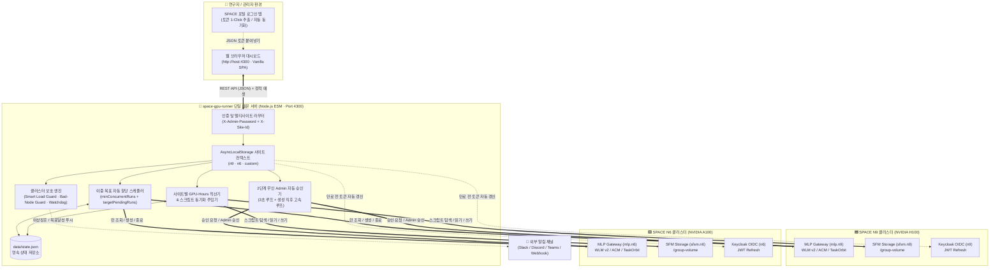
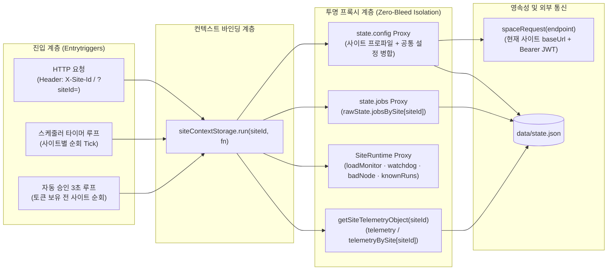
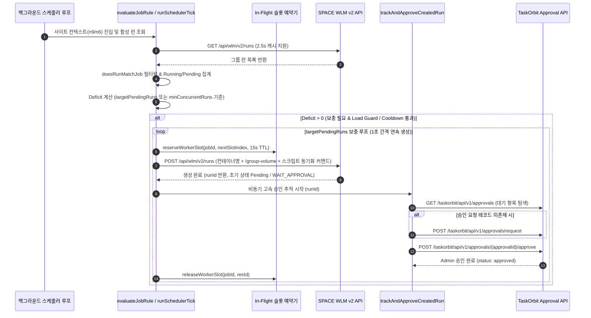
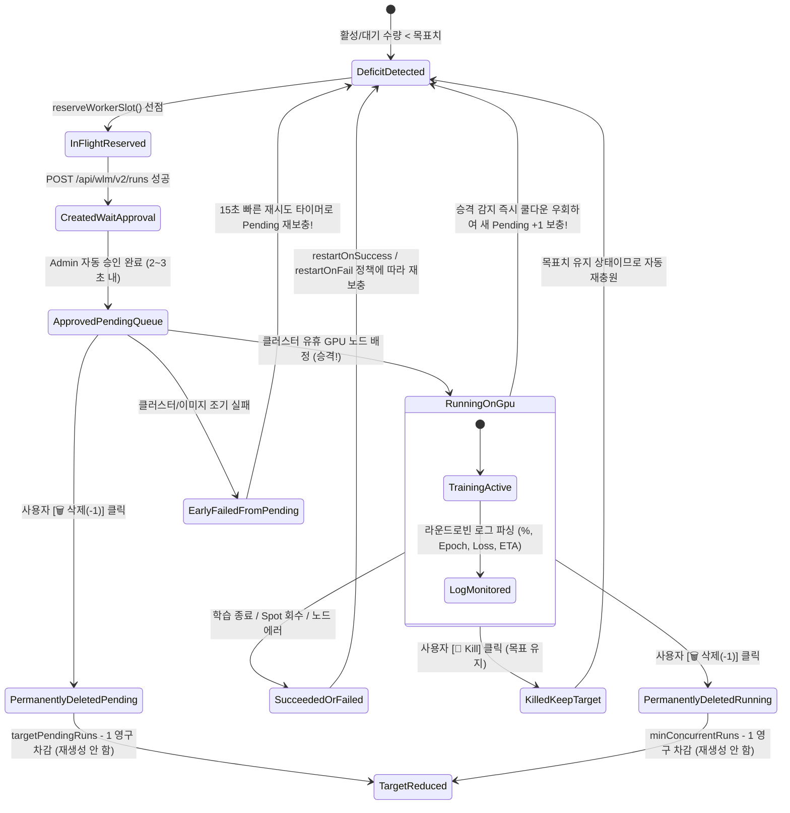
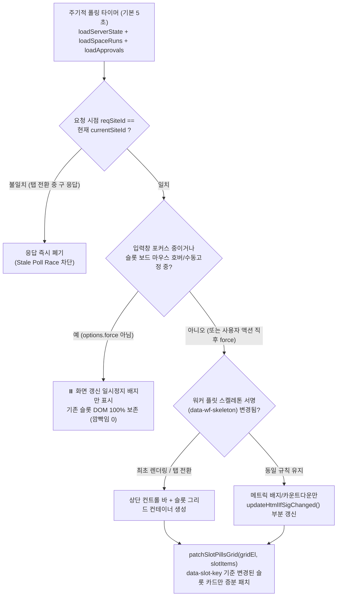
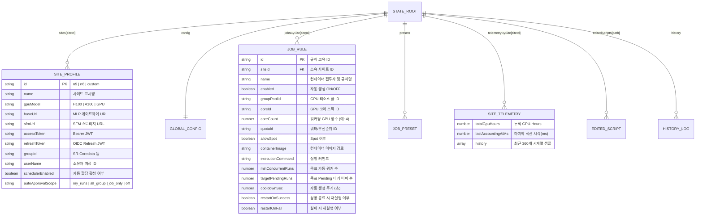

# 📘 SPACE Multi-Site GPU Auto-Allocator & Admin Run-Approval Server
## 소프트웨어 구성 및 상세 설계 명세서 (SRS & SDD)

- **문서 버전**: `v2.1.0`
- **최종 갱신일**: `2026-11-13`
- **대상 시스템**: `space-gpu-runner` (`server.mjs`, `public/index.html`, `public/app.js`, `public/style.css`)
- **운영 대상 클러스터**: `SPACE N9 (NVIDIA H100)` · `SPACE N6 (NVIDIA A100)` · 사용자 추가 커스텀 SPACE 클러스터

---

## 📑 목차 (Table of Contents)

1. [시스템 개요 및 목적](#1-시스템-개요-및-목적)
2. [요구사항 명세서 (SRS)](#2-요구사항-명세서-srs)
   - [2.1 기능 요구사항 (Functional Requirements)](#21-기능-요구사항-functional-requirements)
   - [2.2 비기능 요구사항 (Non-Functional Requirements)](#22-비기능-요구사항-non-functional-requirements)
   - [2.3 요구사항 추적 매트릭스 (Traceability Matrix)](#23-요구사항-추적-매트릭스-traceability-matrix)
3. [핵심 설계 지침 및 엔지니어링 원칙](#3-핵심-설계-지침-및-엔지니어링-원칙)
4. [소프트웨어 구성 및 디렉터리 구조](#4-소프트웨어-구성-및-디렉터리-구조)
5. [시스템 아키텍처 상세 (Mermaid 다이어그램 포함)](#5-시스템-아키텍처-상세)
   - [5.1 전체 시스템 컨텍스트 아키텍처](#51-전체-시스템-컨텍스트-아키텍처)
   - [5.2 백엔드 계층 및 멀티 사이트 AsyncLocalStorage 격리 구조](#52-백엔드-계층-및-멀티-사이트-asynclocalstorage-격리-구조)
   - [5.3 이중 백그라운드 루프 및 워커 할당·자동승인 시퀀스](#53-이중-백그라운드-루프-및-워커-할당자동승인-시퀀스)
   - [5.4 워커 슬롯 수명주기 및 targetPendingRuns 상태 머신](#54-워커-슬롯-수명주기-및-targetpendingruns-상태-머신)
   - [5.5 프론트엔드 SPA 및 Flicker-Free DOM 렌더링 아키텍처](#55-프론트엔드-spa-및-flicker-free-dom-렌더링-아키텍처)
6. [백엔드 핵심 서브시스템 상세 설계 (`server.mjs`)](#6-백엔드-핵심-서브시스템-상세-설계-servermjs)
7. [프론트엔드 대시보드 상세 설계 (`public/*`)](#7-프론트엔드-대시보드-상세-설계-public)
8. [데이터 모델 및 영속성 스키마 (`data/state.json`)](#8-데이터-모델-및-영속성-스키마-datastatejson)
9. [전체 REST API 명세서](#9-전체-rest-api-명세서)
10. [보안, 멀티테넌트 안전 및 장애 복구 설계](#10-보안-멀티테넌트-안전-및-장애-복구-설계)
11. [설치, 환경변수 및 운영 가이드](#11-설치-환경변수-및-운영-가이드)

---

## 1. 시스템 개요 및 목적

### 1.1 개발 배경 및 해결 과제
대규모 딥러닝·분산 학습 실험을 수행하는 사내 GPU 클러스터(**SPACE 플랫폼**) 운영 환경에서는 다음과 같은 구조적 병목과 운영 리스크가 존재했습니다.

1. **GPU 자원 경쟁 및 Spot 선점 회수**: 클러스터 내 유휴 GPU가 불규칙하게 발생하고 Spot 인스턴스가 수시로 회수(Preemption)되므로, 사람이 수동으로 빈 노드를 감시하며 런을 재제출하기 어렵습니다.
2. **Group Admin `/run-approval` 수동 승인 병목**: 워크로드(`WLM Run`) 제출 후 그룹 관리자(Admin) 승인이 완료되기 전까지 컨테이너가 스케줄링 대기열에 진입하지 못합니다.
3. **클러스터 대기열(Pending Queue) 선점 필요성**: 노드가 비는 즉시 GPU를 배정받으려면, 현재 가동(`Running`) 워커 수와는 별개로 **일정 개수의 `Pending` 대기 워커(`targetPendingRuns`)를 항상 큐에 유지**하고 `Pending ➔ Running` 전환 즉시 대기열을 재보충해야 합니다.
4. **다중 사이트(N9 H100 / N6 A100) 통합 관리**: `SPACE N9`(`H100`)와 `SPACE N6`(`A100`)는 서로 다른 API 게이트웨이·Keycloak 인증 서버·토큰 수명주기·GPU 코어 체계를 사용하므로 사이트별 독립 토큰/규칙/텔레메트리 격리가 필수적입니다.
5. **공유 그룹(`SR-Coredata`) 내 타 사용자 보호**: 동일 그룹 내 여러 연구자가 동시에 워크로드를 구동하므로, 자동 종료·일괄 제어·Watchdog·자동 승인이 **타 사용자의 워크로드를 절대 건드리지 않는 엄격한 멀티테넌트 안전 장치**가 요구됩니다.
6. **고빈도 실시간 모니터링 시 화면 깜빡임(Flickering)**: 수십 개의 워커 슬롯을 실시간 갱신할 때 전체 HTML을 매번 다시 그리면 스크롤 튀김·버튼 클릭 유실·시각적 피로가 발생합니다.

### 1.2 시스템 목적
`space-gpu-runner`는 외부 패키지 의존성 없이 단일 Node.js 프로세스로 동작하며, **멀티 사이트 GPU 자동 할당 스케줄링**, **목표 Pending 대기열 상시 유지**, **3초 주기 무인 Admin 자동 승인**, **개별/범위 워커 슬롯 즉시 Kill 및 영구 삭제(`-1`)**, **클러스터 부하 보호 및 불량 노드 회피**, **Flicker-Free 실시간 모니터링 웹 대시보드**를 통합 제공하는 고가용성 무인 자동화 서버입니다.

### 1.3 외부 연동 대상 시스템
| 연동 대상 | SPACE N9 (H100 클러스터) | SPACE N6 (A100 클러스터) | 프로토콜 / 역할 |
| :--- | :--- | :--- | :--- |
| **SPACE 포털** | `https://space.n9.sr-cloud.com` | `https://space.n6.sr-cloud.com` | 사용자 웹 콘솔 및 OIDC 세션 발급 |
| **MLP API Gateway** | `https://mlp.n9.sr-cloud.com` | `https://mlp.n6.sr-cloud.com` | WLM(`/api/wlm/v2/*`), ACM(`/api/acm/*`), TaskOrbit(`/taskorbit/api/v1/*`) |
| **SFM 스토리지 API** | `https://sfsm.n9.sr-cloud.com` | `https://sfsm.n6.sr-cloud.com` | `/group-volume` 디렉터리 탐색 및 실행 스크립트 읽기/쓰기 |
| **Keycloak OIDC** | `keycloak.n9-local.sr-cloud.com` | `keycloak.n6-local.sr-cloud.com` | Bearer `access_token` 검증 및 `refresh_token` 무중단 갱신 |
| **알림 Webhook** | Slack / Discord / Teams / Custom HTTP | 동일 | 장애·목표달성·토큰만료 이벤트 실시간 푸시 |

---

## 2. 요구사항 명세서 (SRS)

### 2.1 기능 요구사항 (Functional Requirements)

| ID | 분류 | 요구사항 명칭 | 상세 요구사항 및 수용 기준 (Acceptance Criteria) | 우선순위 |
| :--- | :--- | :--- | :--- | :---: |
| **FR-01** | 멀티사이트 | 다중 SPACE 사이트 통합 및 독립 토큰 관리 | N9(H100), N6(A100) 및 추가 커스텀 사이트별로 API URL, `accessToken`, `refreshToken`, `groupId`, `jobs`, `telemetry`를 완전 분리 저장·운영해야 한다. | 필수(P0) |
| **FR-02** | 인증/토큰 | 토큰 원클릭 추출 및 자동 갱신 | 브라우저 콘솔 스니펫 붙여넣기 시 JWT `iss` 클레임으로 대상 사이트(N9/N6)와 `groupId`, `userName`을 자동 식별하고, 만료 5분 전 `refreshToken`으로 자동 갱신해야 한다. | 필수(P0) |
| **FR-03** | 자동탐색 | Zero-Config 클러스터 리소스 탐색 | 토큰 입력만으로 소속 그룹, GPU 풀, 코어 스펙(N9는 `H100` 풀카드, N6는 `A100` 풀카드 최우선 선택), 쿼터(Priority), 컨테이너 이미지를 자동 바인딩해야 한다. | 필수(P0) |
| **FR-04** | 스케줄링 | 목표 워커 수(`minConcurrentRuns`) 유지 및 다단 생성 주기 | 규칙별 목표 워커 수(`1~9999`) 미달 시 자동 생성하며, 워커 생성 간격으로 **5초, 15초, 30초, 1분, 2분, 3분, 5분, 10분** 및 직접 입력을 지원해야 한다. | 필수(P0) |
| **FR-05** | 대기열유지 | 목표 Pending 대기 수(`targetPendingRuns`) 상시 유지 | `targetPendingRuns > 0` 설정 시 현재 Running 수와 무관하게 지정된 Pending 대기열 개수를 일괄 보충하여 유지하고, `Pending ➔ Running/Succeeded` 승격 감지 시 쿨다운을 우회해 즉시 보충하며, `Pending ➔ Failed` 조기 실패 시 15초 내 신속 재보충해야 한다. | 필수(P0) |
| **FR-06** | 자동승인 | 무인 Group Admin 자동 승인 (`/run-approval`) | 3초 주기 백그라운드 루프 및 런 생성 직후 고속 연속 승인 루프를 통해 TaskOrbit 승인 요청(`request`)과 Admin 승인(`approve`)을 자동 수행하며, 승인 범위(`my_runs`, `all_group`, `job_only`, `off`)를 엄격히 준수해야 한다. | 필수(P0) |
| **FR-07** | 슬롯제어 | 특정 워커 슬롯 선택 즉시 Kill 및 영구 삭제(`-1`) | 대시보드에서 개별 슬롯 클릭, 체크박스 다중 선택, 번호/범위 입력(`1, 5, 58-62, #360146`)으로 ① **즉시 Kill(`🛑`, 자동충원 유지)** 및 ② **영구 삭제(`🗑️`, 강제 종료 + 목표치 자동 차감으로 재생성 방지)** 를 수행할 수 있어야 한다. | 필수(P0) |
| **FR-08** | UI최적화 | 실시간 모니터링 화면 깜빡임(Flicker) 완화 | 시그니처(`data-render-sig`) 비교 및 슬롯 키(`data-slot-key`) 단위 증분 DOM 패치를 적용하고, 슬롯 영역 마우스 호버 시 자동 리렌더링 일시정지(Hover-Freeze) 및 수동 화면 고정 토글을 제공해야 한다. | 필수(P0) |
| **FR-09** | 그룹안전 | 공유 그룹 내 타 사용자 워크로드 완벽 보호 | `stop_all`, `stop_pending`, `rolling_restart`, Watchdog, 로그 스캐너는 오직 내 규칙 매칭 런만 대상으로 동작하며, 타 사용자(`!mine`) 런은 UI에서 Kill 버튼을 숨기고 백엔드에서도 `403 Forbidden`으로 차단해야 한다. | 필수(P0) |
| **FR-10** | 부하보호 | 스마트 클러스터 부하 보호 (`Smart Load Guard`) | SPACE API 응답 지연·429/5xx 에러 시 지수 백오프를 적용하고, `targetPendingRuns === 0` 모드에서 동시 준비 중(`Pending/Creating`) 워커 상한을 제어하며 적응형 폴링 주기를 조절해야 한다. | 높음(P1) |
| **FR-11** | 노드보호 | 불량 노드 조기 실패 감지 (`Bad-Node Guard`) | 컨테이너 시작 후 `180초` 이내 실패 또는 `Xid`/`ECC`/`NVML`/`CUDA init` 치명 에러 감지 시 불량 노드 재할당 방지를 위한 스마트 쿨다운(`25초`)을 자동 적용해야 한다. | 높음(P1) |
| **FR-12** | 자가치유 | Watchdog 좀비 청소 및 라운드로빈 로그 감시 | 장기 고착 비정상 런을 자동 정리(단, `targetPendingRuns > 0` 또는 장기 주기 정책 시 최소 360분 보호)하고, 러닝 워커 로그에서 진행률(`%`, `Epoch`, `Step`, `Loss`, `ETA`) 추출 및 에러/완료 키워드 감지를 수행해야 한다. | 높음(P1) |
| **FR-13** | 폴백/스케일 | Spot↔On-Demand 하이브리드 폴백 및 시간대 스케일링 | Spot 반복 실패 시 대체 GPU 코어/표준 모드로 폴백하고, 주간·야간·주말 시간대별 목표 워커 수를 자동 조정하는 옵션을 제공해야 한다. | 보통(P2) |
| **FR-14** | 배포편의 | `/group-volume` 웹 스크립트 에디터 & 롤링 배포 | 대시보드 내에서 `/group-volume/run.sh` 등 실행 스크립트를 직접 편집·저장하고 컨테이너 시작 시 Base64 동기화 주입 및 무중단 배치 롤링 재시작을 지원해야 한다. | 보통(P2) |
| **FR-15** | 운영리포트 | 실험 프리셋 북마크 및 사이트별 GPU-Hours 리포트 | 자주 쓰는 규칙 구성을 프리셋으로 원클릭 전환하고, 사이트별로 독립 적산된 `GPU-Hours` 시계열 차트 및 `CSV`/`JSON` 내보내기를 제공해야 한다. | 보통(P2) |

---

### 2.2 비기능 요구사항 (Non-Functional Requirements)

| ID | 품질 속성 | 요구사항 명세 | 목표 지표 / 설계 기준 |
| :--- | :--- | :--- | :--- |
| **NFR-01** | **무의존성 (Portability)** | 외부 `npm` 패키지 설치 없이 순수 Node.js(`>=20`) 내장 표준 라이브러리만으로 구동 | `dependencies: 0개` (`node:http`, `node:fs`, `node:path`, `node:async_hooks`, 내장 `fetch`) |
| **NFR-02** | **연속 가용성 (Availability)** | 수주~수개월 무중단 데몬 구동 시 프로세스 크래시 방지 | 전역 예외 격리, 개별 API 타임아웃(`15s`), 비동기 루프 상호 독립 구동 |
| **NFR-03** | **메모리 안정성 (Bounded Memory)** | 장기 가동 시 인메모리 로그·승인이력·실패런 캐시의 무한 증가 원천 차단 | 히스토리 500건, 로그 스니펫 80키, 승인맵 300건, 실패런셋 500건, 알림중복맵 5분 TTL 강제 |
| **NFR-04** | **멀티사이트 격리성 (Isolation)** | 동시 다발적인 N9·N6 HTTP 요청 및 백그라운드 루프 간 상태 오염 제로 보장 | `AsyncLocalStorage`(`siteContextStorage`) 기반 요청/루프 단위 사이트 컨텍스트 바인딩 |
| **NFR-05** | **멀티테넌트 안전성 (Safety)** | 공유 그룹(`SR-Coredata`) 내 타 계정 워크로드 종료·오염 확률 0% | UI 버튼 제거 + API 소유자 검증(`403`) + `doesRunMatchSiteJobs` 3중 방어 |
| **NFR-06** | **UI 반응성 (Responsiveness)** | 5초 주기 자동 새로고침 시 DOM 재구축 최소화 및 입력 포커스 보존 | 변경 없는 슬롯 DOM 재사용률 `100%`, 입력창 포커스·호버 중 리렌더 스킵 |
| **NFR-07** | **보안성 (Security)** | 대시보드 잠금 인증 강제 및 XSS/인라인 스크립트 인젝션 차단 | 모든 `/api/*` `X-Admin-Password` 검증, HTML(`escapeHtml`) 및 JS 문자열(`escapeJsStr`) 분리 이스케이프 |
| **NFR-08** | **상태 영속성 (Durability)** | 데몬 재시작 시에도 모든 사이트 토큰, 규칙, 프리셋, 누적 GPU-Hours 100% 복원 | `data/state.json` 즉시 동기 저장 및 레거시 스키마 자동 마이그레이션 |

---

### 2.3 요구사항 추적 매트릭스 (Traceability Matrix)

| 요구사항 ID | 백엔드 구현 모듈 (`server.mjs`) | 프론트엔드 구현 모듈 (`public/app.js`) | 검증 테스트 ID (`tests/run-tests.mjs`) |
| :--- | :--- | :--- | :--- |
| **FR-01, NFR-04** | `siteContextStorage`, `createSiteScopedConfigProxy`, `createSiteRuntimeObjectProxy`, `buildSitesSummaryPayload` | `selectSpaceSite`, `renderMultiSiteSwitcherBar`, `api()` (`X-Site-Id`) | `TC-13`, `TC-21`, `TC-22`, `TC-23` |
| **FR-02, FR-03** | `detectSiteIdFromTokenOrText`, `refreshAccessToken`, `GET /api/space/discover`, `selectPreferredGpuCore` | `applyQuickPasteJson`, `discoverSpaceResources`, `populateCoresForPool` | `TC-13`, `TC-14` |
| **FR-04, FR-05** | `runSchedulerTick`, `evaluateJobRule`, `pickNextWorkerSlot`, `reserveWorkerSlot` | `quickUpdateTargetWorkers`, `quickUpdateTargetPending`, `quickUpdateSpawnInterval` | `TC-09`, `TC-10`, `TC-12` |
| **FR-06** | `processPendingApprovals`, `trackAndApproveCreatedRun`, `buildAutoApprovalTimeline` | `loadApprovals`, `approveSingleItem`, `approveAllPending` | `TC-09`, 실전 Soak 검증 |
| **FR-07** | `POST /api/space/runs/:id/stop`, `POST /api/space/runs/bulk-action` | `killSingleWorkerSlot`, `executeSelectedWorkersKill`, `parseSlotSpecToRunIds` | `TC-11`, `TC-18` |
| **FR-08, NFR-06** | `computeWorkerFleetStats` (정렬 및 안정적 슬롯 키 부여) | `updateHtmlIfSigChanged`, `patchSlotPillsGrid`, `setSlotGridHover`, `toggleSlotBoardFreeze` | `TC-04`, UI 호버 시나리오 검증 |
| **FR-09, NFR-05** | `doesRunMatchJob`, `doesRunMatchSiteJobs`, `resolveCurrentUserName`, `/stop` `403` 가드 | `renderSpaceRunsTable` (`🔒 타유저 보호`), `reconciliationBarHtml` | `TC-05`, `TC-06`, `TC-07`, `TC-08` |
| **FR-10 ~ FR-12** | `computeServerLoadStatus`, `runWatchdogSweep`, `scanWorkerLogsRoundRobin`, `parseWorkerLogProgress` | `quickUpdateLoadGuard`, `renderWorkerFleetBoard` | `TC-15`, `TC-21` |
| **NFR-07** | `/api/auth/verify`, `/api/*` 인증 미들웨어 | `submitPassword`, `lockDashboard`, `escapeHtml`, `escapeJsStr` | `TC-16`, `TC-17`, `TC-19`, `TC-20` |

---

## 3. 핵심 설계 지침 및 엔지니어링 원칙

본 프로젝트의 모든 코드 수정과 기능 확장은 아래 **8대 설계 지침(Design Guidelines)** 을 엄격히 준수합니다.

### 지침 1. 외부 의존성 제로 (Zero-Dependency Self-Contained Architecture)
- 폐쇄망·사내 연구 서버 환경에서도 `npm install` 없이 `node server.mjs` 한 줄로 즉시 기동되도록 **외부 패키지를 일절 사용하지 않습니다.**
- HTTP 서버(`node:http`), 비동기 컨텍스트(`node:async_hooks`), 파일 I/O(`node:fs`), 업스트림 통신(내장 `fetch` + `AbortSignal.timeout`), 테스트 러너(`node:test`)까지 모두 Node.js 표준 내장 기능으로 구현합니다.

### 지침 2. `AsyncLocalStorage` + `Proxy` 기반 멀티 사이트 투명 격리 지침
- 단일 프로세스가 N9(H100)와 N6(A100)를 동시에 스케줄링하고 대시보드 요청을 처리하므로, 전역 변수 공유로 인한 사이트 간 상태 오염(Cross-Site Bleed)을 원천 차단해야 합니다.
- 모든 HTTP 요청 진입점(`req.headers["x-site-id"]`)과 백그라운드 루프(`for (const sid of siteIds)`)는 반드시 `siteContextStorage.run(sid, ...)` 컨텍스트 내부에서 실행됩니다.
- `state.config`, `state.jobs`, `loadMonitorStats`, `watchdogStats`, `badNodeStats`, `pipelineStats`는 **동적 ES6 `Proxy` 객체**로 구현되어, 호출 코드가 현재 `siteId`를 일일이 인자로 넘기지 않아도 자동으로 현재 `AsyncLocalStorage` 사이트의 저장소와 런타임 메모리를 읽고 쓰도록 설계합니다.

### 지침 3. 공유 그룹(`SR-Coredata`) 멀티테넌트 3중 방어(Defense-in-Depth) 지침
SPACE WLM의 `GET /api/wlm/v2/runs` API는 그룹 Admin 권한 토큰 사용 시 **그룹 내 모든 동료 연구자의 워크로드까지 함께 반환**합니다. 따라서 타인의 실험을 절대 방해하지 않도록 3단계 방어선을 강제합니다.
1. **1차 방어 (프론트엔드 UI 차단)**: `renderSpaceRunsTable` 및 대조표 배지에서 내 계정(`mine`)이 아닌 워크로드는 체크박스와 `🛑 Kill` / `🗑️ 삭제` 버튼을 렌더링하지 않고 `🔒 타유저 보호` 배지만 표시합니다.
2. **2차 방어 (백엔드 종료 API `403` 거절)**: `POST /api/space/runs/:id/stop` 및 `POST /api/space/runs/bulk-action`에서 대상 런의 소유자(`userId`/`userName`)가 현재 사이트 사용자와 다를 경우 즉시 `403 Forbidden`으로 차단합니다.
3. **3차 방어 (자동화 루프 규칙 스코프 제한)**: `stop_all`, `stop_pending`, `rolling_restart`, `runWatchdogSweep`, `scanWorkerLogsRoundRobin`은 반드시 `doesRunMatchSiteJobs(run, state.jobs)`를 통과한 **내 규칙 소속 컨테이너만** 조작합니다.

### 지침 4. 이중 목표 스케줄링(`minConcurrentRuns` vs `targetPendingRuns`) 분리 지침
- **일반 가동 목표 모드 (`targetPendingRuns === 0`)**:
  $$\text{Deficit} = \max\left(0,\; \text{minConcurrentRuns} - (\text{Running} + \text{Pending} + \text{InFlight})\right)$$
  전체 활성 워커가 목표 수량에 도달할 때까지 설정된 생성 간격(`cooldownSec`)에 맞춰 순차 할당합니다.
- **목표 Pending 버퍼 유지 모드 (`targetPendingRuns > 0`)**:
  $$\text{Deficit} = \max\left(0,\; \text{targetPendingRuns} - (\text{Pending} + \text{InFlight})\right)$$
  현재 몇 개가 `Running` 중이든 상관없이 클러스터 대기열에 항상 `targetPendingRuns`개의 `Pending` 워커가 대기하도록 **단일 틱 내 다중 생성 루프(1초 간격 연속 생성)** 로 즉시 채웁니다.
  - 기존 `_knownPendingRunIds`에 있던 워커가 `Running` 또는 `Succeeded`로 승격되면 **쿨다운(`cooldownSec`)을 즉시 우회(`shouldBypassCooldown = true`)** 하여 빈 대기 슬롯을 실시간 보충합니다.
  - 일시적 스로틀링 등으로 배치가 덜 채워진 경우 `_incompletePendingBatchRetryAtMs`(15~30초) 타이머를 예약해 최대 10분 쿨다운을 기다리지 않고 신속히 재시도합니다.
- **슬롯 영구 삭제(`reduceTarget: true`) 시 독립 차감 수식**:
  - `targetPendingRuns > 0` 상태에서 **Pending 슬롯**을 영구 삭제하면 `minConcurrentRuns`(Running 목표)는 건드리지 않고 **`targetPendingRuns`만 `-1` 차감**합니다.
  - 반대로 **Running 슬롯**을 영구 삭제하거나 `targetPendingRuns === 0`인 경우에는 **`minConcurrentRuns`를 `-1` 차감**합니다.

### 지침 5. 클러스터 과부하 보호 및 불량 노드 회피 지침
- API 레이턴시가 임계치(`1800ms` 경고 / `3500ms` 위험)를 넘거나 `HTTP 429 / 502 / 503 / 504` 응답 발생 시 자동으로 지수 백오프(`backoffUntilMs`)를 발동하여 SPACE 게이트웨이 장애 확산을 막습니다.
- 동일 틱/다중 요청 중 중복 컨테이너 생성을 막기 위해 `createRun` 호출 직전 `reserveWorkerSlot(jobId, slotIndex, 15000)`으로 인플라이트 슬롯을 선점 예약합니다.
- 컨테이너 기동 후 `badNodeRapidFailSec`(`180초`) 이내 조기 실패가 감지되면 해당 물리 GPU 노드가 즉시 재할당되는 현상(Hot-Potato Loop)을 막기 위해 `badNodeCooldownSec`(`25초`) 동안 안전 대기합니다(단, `targetPendingRuns > 0` 대기열 채움은 클러스터 큐잉이므로 블로킹하지 않음).

### 지침 6. 24×365 연속 가동 메모리 상한(Bounded Memory) 지침
- 데몬이 수주~수개월 재시작 없이 운영되어도 힙 메모리가 선형 증가하지 않도록 모든 인메모리 컬렉션에 엄격한 크기 상한과 TTL 정리를 적용합니다.
  - `state.history`: 최대 `500`건 유지 (중요 할당/승인 로그 `350`건 보존 우선순위 적용)
  - `telemetry.history`: 사이트별 최대 `360`개 시계열 샘플 유지
  - `watchdogStats.workerLogSnippets`: `80`키 초과 시 현재 활성 런 + 최근 `30`개만 유지
  - `rt.lastKnownApprovalsMap`: 최대 `300`건 FIFO 정리
  - `badNodeStats.seenFailedRunIds`: 최대 `500`건 슬라이싱 유지
  - `recentAlertDedupeMap`: `5분` 경과 엔트리 자동 삭제

### 지침 7. Flicker-Free DOM 차분 렌더링 및 호버 정지(Hover-Freeze) 지침
- 대시보드는 5초마다 상태를 폴링하지만, `innerHTML` 전체 덮어쓰기를 금지하고 두 단계 차분 업데이트를 수행합니다.
  1. `updateHtmlIfSigChanged(el, sig, html)`: 데이터 핵심 속성으로 조합한 시그니처 문자열(`data-render-sig`)이 이전과 동일하면 DOM 조작을 완전히 건너뜁니다.
  2. `patchSlotPillsGrid(gridEl, slotItems)`: 워커 슬롯 그리드는 개별 슬롯 카드(`data-slot-key`) 단위로 추가·제거·변경된 카드만 핀포인트 패치하여 나머지 수십 개 카드의 호버·체크 상태를 그대로 유지합니다.
- 사용자가 슬롯 보드나 런 테이블 위에 마우스를 올리면(`isMouseOverSlotGrid`, `isMouseOverRunsTable`) 자동 리렌더링을 일시 동결하여 버튼이 움직이지 않게 보호합니다. 이때 동결된 버튼이 구버전 정수를 전송하지 않도록 대기열 감소 버튼 등은 **상대 증감 페이로드(`{ delta: -1 }`)** 를 사용합니다.

### 지침 8. 인라인 핸들러 이중 컨텍스트 보안 이스케이프 지침
- HTML 본문 및 일반 속성에는 `escapeHtml(str)`(`&`, `<`, `>`, `"`, `'` 엔티티 치환)을 사용합니다.
- `onclick="fn('...')"`와 같은 인라인 자바스크립트 문자열 인자에는 브라우저가 **① HTML 엔티티 디코딩 ➔ ② JS 문자열 리터럴 파싱** 순서로 해석하므로, 반드시 백슬래시와 작은따옴표를 먼저 JS 이스케이프(`\\`, `\'`)한 뒤 HTML 엔티티 치환을 수행하는 전용 **`escapeJsStr(str)`** 를 사용하여 구문 오류와 XSS를 동시에 차단합니다.

---

## 4. 소프트웨어 구성 및 디렉터리 구조

```text
space-gpu-runner/
├── package.json                              # 프로젝트 메타데이터 및 실행/테스트 스크립트 (외부 의존성 0개)
├── server.mjs                                # 백엔드 단일 통합 데몬 서버 (~6,950 lines, Node.js ESM)
├── README.md                                 # 빠른 시작 가이드 및 문서 인덱스
├── public/                                   # 프론트엔드 정적 웹 에셋 (Vanilla ES6 SPA)
│   ├── index.html                            # 대시보드 레이아웃 마크업 (잠금화면, 멀티사이트 바, 모니터링/설정 뷰)
│   ├── app.js                                # 대시보드 상태 제어, 차분 렌더링, 슬롯 제어, 차트 로직 (~4,870 lines)
│   └── style.css                             # 다크 테마 반응형 그리드, 배지, 슬롯 카드 스타일시트
├── data/                                     # 런타임 영속 데이터 디렉터리 (.gitignore 처리)
│   └── state.json                            # 멀티 사이트 토큰, 규칙, 프리셋, 편집 스크립트, GPU-Hours 영구 저장소
├── tests/                                    # 무의존성 비파괴 자동화 테스트 스위트
│   └── run-tests.mjs                         # 정적구문·도메인로직·보안·라이브 API 계약 23개 자동 검증 스크립트
└── docs/                                     # 엔지니어링 설계 및 테스트 문서
    ├── SOFTWARE_ARCHITECTURE_AND_DESIGN.md   # 소프트웨어 구성 및 상세 설계 명세서 (본 문서)
    └── TESTING_STRATEGY_AND_REPORT.md        # 테스트 구성 전략 및 수행 결과 보고서
```

### 구성 파일별 상세 역할
| 구성 요소 | 코드 규모 | 핵심 책임 (Responsibilities) |
| :--- | :---: | :--- |
| [`server.mjs`](file:///home/kms/dev/space-gpu-runner/server.mjs) | ~6,950 lines | 멀티 사이트 컨텍스트 엔진, SPACE WLM/ACM/TaskOrbit/SFM/Keycloak 클라이언트, 자동 할당 스케줄러, 3초 자동 승인 루프, Smart Load Guard, Bad-Node Guard, Watchdog/로그 파서, GPU-Hours 적산기, 31개 REST API 및 정적 파일 서빙 |
| [`public/index.html`](file:///home/kms/dev/space-gpu-runner/public/index.html) | ~960 lines | 보안 잠금 오버레이, 멀티 사이트 탭 바, 실시간 모니터링 대시보드 뷰, 설정/규칙 편집 뷰, 로그 뷰어, `/group-volume` 스크립트 에디터 UI 구조 정의 |
| [`public/app.js`](file:///home/kms/dev/space-gpu-runner/public/app.js) | ~4,870 lines | 사이트별 API 통신(`X-Site-Id`), Flicker-Free 시그니처/슬롯 패치 엔진, 슬롯 개별·범위 Kill/영구삭제, 빠른 목표/주기 제어, 토큰 자동 파싱, Canvas 기반 GPU-Hours 차트 렌더링 |
| [`public/style.css`](file:///home/kms/dev/space-gpu-runner/public/style.css) | ~260 lines | 고대비 다크 관제 UI 디자인 시스템, 워커 상태별 컬러 코딩(Running 에메랄드, Pending 앰버, 타유저 퍼플, 위험 로즈), 반응형 레이아웃 |
| [`tests/run-tests.mjs`](file:///home/kms/dev/space-gpu-runner/tests/run-tests.mjs) | ~490 lines | `node:vm` 기반 실제 프로덕션 함수 추출 단위 테스트, DOM 바인딩 정합성 검사, XSS 라운드트립 검증, 라이브 포트 `4300` 비파괴 계약 검증 |

---

## 5. 시스템 아키텍처 상세

### 5.1 전체 시스템 컨텍스트 아키텍처



---

### 5.2 백엔드 계층 및 멀티 사이트 `AsyncLocalStorage` 격리 구조



> [!IMPORTANT]
> **핵심 설계 포인트**: `updateGpuTelemetry`, `computeServerLoadStatus`, `runWatchdogSweep`, `evaluateJobRule` 등 모든 도메인 함수는 전역 변수를 직접 참조하지 않고 `Proxy`를 통해 현재 `siteContextStorage`의 사이트 전용 슬롯에만 접근합니다. 따라서 사용자가 대시보드에서 N6(0 GPU) 탭을 클릭해 조회하더라도 N9(80 H100 GPU)의 `lastAccountingAtMs`나 GPU-Hours 시계열 데이터가 절대 덮어써지지 않습니다.

---

### 5.3 이중 백그라운드 루프 및 워커 할당·자동승인 시퀀스



---

### 5.4 워커 슬롯 수명주기 및 `targetPendingRuns` 상태 머신



---

### 5.5 프론트엔드 SPA 및 Flicker-Free DOM 렌더링 아키텍처



---

## 6. 백엔드 핵심 서브시스템 상세 설계 (`server.mjs`)

### 6.1 멀티 사이트 상태 및 런타임 관리 계층
- **주요 함수**: [`loadState`](file:///home/kms/dev/space-gpu-runner/server.mjs#L267-L449), [`createSiteScopedConfigProxy`](file:///home/kms/dev/space-gpu-runner/server.mjs#L490-L537), [`createSiteScopedJobsProxy`](file:///home/kms/dev/space-gpu-runner/server.mjs#L539-L616), [`getSiteRuntime`](file:///home/kms/dev/space-gpu-runner/server.mjs#L991-L1112), [`createSiteRuntimeObjectProxy`](file:///home/kms/dev/space-gpu-runner/server.mjs#L1591-L1606)
- **설계 상세**:
  - 디스크의 `data/state.json` 로드 시 단일 사이트 구버전 스키마가 감지되면 자동으로 `sites.n9`(기존 토큰/규칙 승계)와 `sites.n6`(기본 A100 프로파일 및 템플릿 규칙 생성)로 무손실 마이그레이션합니다.
  - `SITE_SCOPED_CONFIG_KEYS`(`baseUrl`, `sfmUrl`, `portalUrl`, `viewerUrl`, `gpuModel`, `accessToken`, `refreshToken`, `groupId`, `orgId`, `userName`, `schedulerEnabled`, `autoApprovalScope`)는 사이트 프로파일(`rawState.sites[siteId]`)에 개별 저장되고, 나머지 운영 정책 키는 공통 설정(`rawState.config`)에서 읽히도록 투명 병합됩니다.

### 6.2 SPACE 게이트웨이 통신 및 JWT 자동 갱신 엔진
- **주요 함수**: [`spaceRequest`](file:///home/kms/dev/space-gpu-runner/server.mjs#L850-L989), [`refreshAccessToken`](file:///home/kms/dev/space-gpu-runner/server.mjs#L1178-L1330), [`fetchCurrentRuns`](file:///home/kms/dev/space-gpu-runner/server.mjs#L1672-L1704)
- **설계 상세**:
  - 모든 업스트림 호출은 `15,000ms` 타임아웃과 응답 시간 계측(`recordApiTelemetry`)을 거칩니다.
  - `HTTP 401` 응답을 수신하거나 JWT `exp` 만료 5분 전이 감지되면, 사이트별 뮤텍스(`rt.refreshInFlightPromise`)를 통해 동시 중복 갱신 없이 Keycloak OIDC 토큰 엔드포인트(`/auth/realms/srcloud/protocol/openid-connect/token`) 또는 MLP 갱신 API를 순차 시도하여 새 `accessToken`과 `refreshToken`을 갱신·영구 저장한 뒤 원래 요청을 자동 재시도합니다.
  - `fetchCurrentRuns`는 `2.5초` 마이크로 캐시와 `mergeWithRecentlyCreatedRuns` 보정을 결합하여, SPACE WLM 인덱싱 지연(생성 직후 1~5초간 목록에 안 보이는 현상)으로 인한 중복 생성과 조기 종료 오판을 방지합니다.

### 6.3 클러스터 리소스 자동 탐색 및 GPU 코어 선택 알고리즘
- **주요 함수**: [`GET /api/space/discover`](file:///home/kms/dev/space-gpu-runner/server.mjs#L5492-L5649), [`selectPreferredGpuCore`](file:///home/kms/dev/space-gpu-runner/server.mjs#L1141-L1161)
- **코어 자동 선택 우선순위**:
  1. `CPU` 전용 코어를 후보에서 제외합니다.
  2. 현재 사이트의 대표 모델명(`N9 ➔ H100`, `N6 ➔ A100`)과 정확히 일치하는 풀카드(`H100` / `NVIDIA H100` / `A100` / `NVIDIA A100`)를 1순위로 선택합니다.
  3. 정확 일치 항목이 없으면 MIG/분할 슬라이스(`fGPU`, `5GB`, `10GB`, `20GB`, `40GB`)가 아닌 풀 GPU 모델을 2순위로 선택합니다.
  4. 이후 모델명 부분 일치 ➔ 첫 번째 비-CPU GPU 코어 순으로 안전하게 폴백합니다.

### 6.4 이중 목표 자동 할당 스케줄러 엔진
- **주요 함수**: [`evaluateJobRule`](file:///home/kms/dev/space-gpu-runner/server.mjs#L4148-L4572), [`runSchedulerTick`](file:///home/kms/dev/space-gpu-runner/server.mjs#L4574-L4835), [`buildRunPayload`](file:///home/kms/dev/space-gpu-runner/server.mjs#L3201-L3400)
- **핵심 메커니즘**:
  1. **규칙 매칭 정확도 보장 ([`doesRunMatchJob`](file:///home/kms/dev/space-gpu-runner/server.mjs#L3630-L3667))**: 컨테이너 접두사 매칭 시 최장 접두사 우선 규칙(Longest-Prefix Wins)을 적용해 `worker-spot` 규칙이 `worker-spot-eval` 규칙의 컨테이너를 가로채지 못하도록 방지합니다.
  2. **쿨다운 지터 보정**: 설정된 생성 간격(`cooldownSec`: 5s ~ 600s) 판정 시 API 왕복 지연으로 인해 정각 틱이 한 주기 밀리지 않도록 `Math.max(500, cooldownMs - 1500)`의 `1.5초` 지터 허용 마진을 적용합니다.
  3. **`targetPendingRuns` 일괄 보충 및 즉시 복구**:
     - `targetPendingRuns > 0`일 때 한 번의 스케줄러 틱에서 최대 `64`회 루프(`1초` 간격)를 돌며 부족한 Pending 수량을 한꺼번에 채웁니다.
     - 이전 틱의 `_knownPendingRunIds`와 현재 상태를 비교하여 ① `Running`/`Succeeded` 승격 발생 시 쿨다운 즉시 우회 보충, ② 자발적 종료가 아닌 `Failed` 전이 발생 시 `15초` 뒤 빠른 재보충 타이머(`_incompletePendingBatchRetryAtMs`)를 가동합니다.
  4. **컨테이너 실행 커맨드 자동 조립 (`buildRunPayload`)**:
     - `/group-volume` 공유 볼륨 마운트 자동 주입
     - 옵션 활성화 시 대시보드 웹 에디터에서 수정한 스크립트 본문을 Base64 인코딩하여 컨테이너 시작 직전 자동 동기화
     - 옵션 활성화 시 `WORKER_ID`, `WORKER_SLOT`, `WORLD_SIZE`, `JOB_NAME` 분산 환경변수 자동 export

### 6.5 2단계 무인 Admin 자동 승인 엔진
- **주요 함수**: [`processPendingApprovals`](file:///home/kms/dev/space-gpu-runner/server.mjs#L2040-L2281), [`trackAndApproveCreatedRun`](file:///home/kms/dev/space-gpu-runner/server.mjs#L2283-L2332)
- **승인 파이프라인**:
  1. `GET /taskorbit/api/v1/approvals` 대기열과 `GET /api/wlm/v2/runs`의 `PENDING`/`WAIT_APPROVAL` 런을 교차 대조합니다.
  2. `autoApprovalScope` 정책 검사:
     - `"my_runs"`: 내 계정(`resolveCurrentUserName()`)이 생성했거나 본 서버가 방금 생성(`recentlyCreatedRunsMap`)한 런만 승인
     - `"job_only"`: 본 서버가 직접 제출한 런만 승인
     - `"all_group"`: 그룹 내 모든 대기 런 승인
     - `"off"`: 자동 승인 비활성화
  3. TaskOrbit에 아직 승인 요청 레코드가 없는 신규 런은 `POST /taskorbit/api/v1/approvals/request`를 먼저 호출하여 승인 티켓을 발행한 뒤, 즉시 `POST /taskorbit/api/v1/approvals/{id}/approve`로 Admin 승인을 완결합니다.

### 6.6 클러스터 보호 엔진 (Smart Load Guard · Bad-Node Guard · Watchdog)
- **Smart Load Guard ([`computeServerLoadStatus`](file:///home/kms/dev/space-gpu-runner/server.mjs#L3402-L3621))**:
  - 최근 API 샘플의 평균/최대 레이턴시와 에러율을 계산하여 서버 상태를 `NORMAL` / `ELEVATED` / `HIGH_LOAD` / `BACKOFF` 4단계로 판정하고 폴링 및 생성 속도를 자동 조절합니다.
- **Bad-Node Guard**:
  - 시작 후 `180초` 이내 실패한 컨테이너 또는 로그에서 `CUDA initialization error`, `uncorrectable ECC`, `Xid`, `NVML` 하드웨어 결함이 발견된 런을 감지해 불량 노드 회피 쿨다운을 적용합니다.
- **Watchdog & Log Scanner ([`runWatchdogSweep`](file:///home/kms/dev/space-gpu-runner/server.mjs#L3130-L3199), [`scanWorkerLogsRoundRobin`](file:///home/kms/dev/space-gpu-runner/server.mjs#L2917-L3121))**:
  - 매 틱마다 내 규칙 소속 `Running` 워커 중 최대 3개씩 라운드로빈으로 로그를 읽어 진행률(`pct`, `stepInfo`, `loss`, `speed`, `eta`)과 느림보 워커(`isStraggler`: 중앙값 대비 45% 미만 속도)를 탐지합니다.
  - 완료 키워드(`ALL_TASKS_COMPLETED` 등) 감지 시 해당 런이 속한 내 규칙만 정확히 자동 정지하거나 다음 스테이지 명령어(`nextStageCommand`)로 파이프라인을 전환합니다.

---

## 7. 프론트엔드 대시보드 상세 설계 (`public/*`)

### 7.1 대시보드 화면 레이아웃 계층
1. **보안 잠금 오버레이 (`#lockOverlay`)**: 최초 진입 및 새로고침 시 항상 활성화되며 비밀번호 검증 전까지 모든 API 폴링을 중단합니다.
2. **멀티 사이트 탭 스위처 바 (`#multiSiteSwitcherBar`)**: `SPACE N9 (H100)`, `SPACE N6 (A100)` 및 `+ 사이트 추가` 탭을 제공하며, 각 사이트의 실시간 `🟢 Running` / `⏳ Pending` / `활성 GPU 장수` / `토큰 상태`를 한눈에 표시합니다.
3. **최상단 무인 자동화 컨트롤 배너 (`#topAutoStatusBanner`)**: 현재 선택된 규칙의 가동률 프로그레스 바, 목표 워커 프리셋 버튼(`-4`, `+4`, `+8`, `40`, `48`, `64`, `100`), 생성 주기 원클릭 버튼(`5초`~`10분`), 최근 자동 할당/자동 승인 타임라인을 표시합니다.
4. **실시간 워커 플릿 보드 (`#workerFleetPanel`)**:
   - **SPACE 실제 워커 실시간 대조표**: `① 내 규칙 워커` vs `② 내 계정 전체` vs `③ 그룹 전체(타유저 포함)` 수치를 투명하게 대조 표시합니다.
   - **빠른 목표/대기열 제어 바**: 목표 가동 워커 수(`minConcurrentRuns`)와 **목표 Pending 대기 수(`targetPendingRuns`: `끄기(0)`, `2`, `4`, `6`, `8`, `12`, `16`, 직접 입력)** 를 즉시 변경합니다.
   - **슬롯 선택·범위 지정 즉시 Kill / 영구 삭제 바**: `⚡ 확인창 없이 클릭 즉시 Kill` 토글, 그룹 선택(`전체`, `Pending만`, `초과Pending만`, `선택해제`), 슬롯 번호/범위 입력창(`예: 1, 5, 58-62, #360146`), 일괄 `🛑 즉시 Kill` 및 `🗑️ 영구 삭제(-N)` 버튼을 제공합니다.
   - **개별 워커 슬롯 카드 그리드**: 각 슬롯별 상태 배지, 경과 시간, 실시간 학습 진행률 바(`Epoch/Step/Loss/ETA`), 로그 보기 버튼, 원클릭 `🛑Kill` 및 `🗑️삭제` 버튼을 렌더링합니다.
5. **실시간 워크로드 테이블 (`#runsTableBody`) & 컨테이너 로그 뷰어 (`#runLogBox`)**: 필터(`전체 활성`, `Running`, `Pending 대기`, `내 계정 활성`, `종료 포함`) 및 타 사용자 보호 배지(`🔒 타유저 보호`)를 지원합니다.
6. **설정 & 고급 도구 뷰**: 토큰 빠른 붙여넣기, 리소스 자동 탐색 드롭다운, 실험 프리셋 북마크 바(`#presetsBarPanel`), `/group-volume` 웹 스크립트 에디터(`#sfmEditorTextarea`), GPU-Hours 누적 텔레메트리 차트 및 CSV/JSON 다운로드 버튼을 제공합니다.

### 7.2 비동기 사이트 전환 경쟁 조건(Race Condition) 방지 설계
사용자가 `N9`에서 `N6`로 사이트 탭을 빠르게 전환할 때, 전환 직전에 출발했던 `N9`의 비동기 폴링 응답이 뒤늦게 도착하여 `N6` 화면을 덮어쓰는 문제를 막기 위해 [`loadServerState`](file:///home/kms/dev/space-gpu-runner/public/app.js#L414-L491), [`loadApprovals`](file:///home/kms/dev/space-gpu-runner/public/app.js#L3742-L3915), [`loadSpaceRuns`](file:///home/kms/dev/space-gpu-runner/public/app.js#L4539-L4565) 모두 요청 시작 시점의 `const reqSiteId = currentSiteId`를 캡처하고 `await api(...)` 직후 `if (currentSiteId !== reqSiteId) return;` 가드로 구 응답을 즉시 폐기합니다.

---

## 8. 데이터 모델 및 영속성 스키마 (`data/state.json`)

### 8.1 핵심 데이터 엔티티 관계 다이어그램 (ERD)



### 8.2 주요 설정 파라미터 명세 (`state.config` & `JobRule`)
| 필드명 | 타입 | 기본값 | 설명 |
| :--- | :---: | :---: | :--- |
| `activeSiteId` | `string` | `"n9"` | 기본 선택 사이트 식별자 (`"n9"`, `"n6"` 등) |
| `checkIntervalSec` | `number` | `15` | 글로벌 기본 스케줄러 체크 간격 (초) |
| `approvalCheckIntervalSec` | `number` | `3` | 백그라운드 Admin 자동 승인 감시 주기 (초, `2~60`) |
| `uiRefreshIntervalSec` | `number` | `5` | 웹 대시보드 자동 폴링 새로고침 주기 (초) |
| `autoApprovalScope` | `string` | `"my_runs"` | 자동 승인 대상 범위 (`"my_runs"` \| `"all_group"` \| `"job_only"` \| `"off"`) |
| `smartLoadGuardEnabled` | `boolean` | `true` | SPACE API 부하 감지 자동 감속 및 백오프 활성화 여부 |
| `maxPendingWorkers` | `number` | `4` | `targetPendingRuns === 0`일 때 동시 준비 허용 워커 상한 |
| `watchdogEnabled` | `boolean` | `true` | 장기 고착 비정상 런 감시 및 라운드로빈 로그 스캔 활성화 |
| `badNodeGuardEnabled` | `boolean` | `true` | 시작 후 `180초` 이내 조기 실패 시 `25초` 불량 노드 회피 쿨다운 적용 |
| `job.minConcurrentRuns` | `number` | `1` | 규칙별 목표 가동 워커 수 (`1 ~ 9999`) |
| `job.targetPendingRuns` | `number` | `0` | 클러스터 큐에 상시 대기시킬 목표 Pending 워커 수 (`0`이면 비활성) |
| `job.cooldownSec` | `number` | `15` | 워커 자동 할당 주기 (`5`, `15`, `30`, `60`, `120`, `180`, `300`, `600`초 등) |

---

## 9. 전체 REST API 명세서

> **공통 인증 및 멀티 사이트 헤더 규칙**
> - `POST /api/auth/verify`를 제외한 모든 `/api/*` 엔드포인트는 `X-Admin-Password: <비밀번호>` 헤더(또는 다운로드 링크용 `?pw=` 쿼리)가 필수이며, 불일치 시 `401 Unauthorized` (`{ locked: true }`)를 반환합니다.
> - 모든 `/api/*` 요청은 `X-Site-Id: n9 | n6` 헤더(또는 `?siteId=`)를 통해 대상 사이트 컨텍스트에서 실행됩니다.

| 분류 | 메서드 | 엔드포인트 경로 | 주요 요청 바디 / 쿼리 | 응답 요약 및 동작 설명 |
| :--- | :---: | :--- | :--- | :--- |
| **인증** | `POST` | `/api/auth/verify` | `{ password }` | 관리자 비밀번호(`cycy`) 일치 여부 검증 (`200` / `401`) |
| **사이트** | `GET` | `/api/sites` | - | 등록된 전 사이트(N9, N6 등) 목록 및 규칙 기준 활성 워커/GPU 요약 반환 |
| **사이트** | `POST` | `/api/sites/select` | `{ siteId }` | 기본 활성 사이트 전환 및 전환된 사이트의 전체 상태 반환 |
| **사이트** | `POST` | `/api/sites` | `{ id, name, gpuModel, baseUrl, ... }` | 신규 SPACE 클러스터 사이트 추가 또는 기존 사이트 프로파일 수정 |
| **사이트** | `DELETE` | `/api/sites/:id` | - | 사용자 추가 커스텀 사이트 삭제 (기본 `n9`, `n6`는 삭제 보호) |
| **상태/설정** | `GET` | `/api/state` | `X-Site-Id` | 현재 사이트의 `config`, `jobs`, `workerFleet`, `telemetry`, `sites`, `history` 통합 조회 |
| **상태/설정** | `POST` | `/api/config` | `{ accessToken, refreshToken, ... }` | 토큰(JWT 사이트 자동 감지 포함), 그룹 ID, 주기 및 스마트 가드 설정 저장 |
| **상태/설정** | `POST` | `/api/automation/quick-update` | `{ watchdogEnabled, ... }` | 고급 자동화 토글 옵션 즉시 부분 업데이트 |
| **상태/설정** | `POST` | `/api/load-guard` | `{ smartLoadGuardEnabled, maxPendingWorkers }` | 스마트 부하 보호 가드 설정 즉시 변경 |
| **탐색/SFM** | `GET` | `/api/space/discover` | - | 그룹, GPU 풀, H100/A100 코어, 쿼터, 스펙, 이미지 일괄 자동 탐색 및 빈 규칙 자동 채움 |
| **탐색/SFM** | `GET` | `/api/space/specification/:id` | - | 특정 SPACE WLM 스펙 상세 정보 조회 |
| **탐색/SFM** | `GET` | `/api/space/sfm-files` | `?path=/group-volume` | SFM 그룹 볼륨 디렉터리 및 스크립트 파일 목록 조회 |
| **탐색/SFM** | `GET` | `/api/space/sfm-file` | `?path=/group-volume/run.sh` | 웹 에디터용 실행 스크립트 파일 본문 조회 |
| **탐색/SFM** | `POST` | `/api/space/sfm-file` | `{ path, content, rollingRestart, batchSize }` | 스크립트 저장(컨테이너 시작 자동 동기화 등록) 및 내 규칙 워커 무중단 롤링 교체 |
| **런/슬롯** | `GET` | `/api/space/runs` | - | 현재 사이트 실시간 런 목록, 승인 상태 매핑, `workerFleet` 및 대조표 반환 |
| **런/슬롯** | `GET` | `/api/space/runs/:id/log` | - | 특정 워커 컨테이너의 최근 표준 출력 로그(500줄) 조회 |
| **런/슬롯** | `POST` | `/api/space/runs/:id/stop` | `{ reduceTarget, jobId }` | 단일 슬롯 즉시 강제 종료(`🛑 Kill`) 또는 목표치 `-1` 차감 영구 삭제(`🗑️`, 타유저 `403` 차단) |
| **런/슬롯** | `POST` | `/api/space/runs/bulk-action` | `{ action, runIds, slotNumbers, jobId }` | `stop_selected`, `delete_selected`, `trim_excess_pending`, `rolling_restart`, `stop_pending`, `stop_all`, `scan_logs` 수행 (내 규칙 런 한정) |
| **승인** | `GET` | `/api/space/approvals` | - | 현재 사이트의 TaskOrbit 승인 대기/최근 처리 목록 및 자동 승인 통계 조회 |
| **승인** | `POST` | `/api/space/approvals/approve` | `{ approvalId, runId, approveAll }` | 단건 또는 대기 전체 워크로드 즉시 Admin 승인 |
| **승인** | `POST` | `/api/space/approvals/reject` | `{ approvalId, comment }` | 특정 승인 대기 요청 반려(Reject) |
| **규칙/스케줄** | `POST` | `/api/jobs` | `JobRule` 객체 (`createAsNew` 지원) | 자동 할당 작업 규칙 신규 생성 또는 수정 |
| **규칙/스케줄** | `DELETE` | `/api/jobs/:id` | - | 특정 작업 규칙 삭제 |
| **규칙/스케줄** | `POST` | `/api/jobs/toggle` | `{ id, enabled }` | 규칙 자동 생성 `ON` / `OFF` 즉시 전환 (`ON` 전환 시 즉시 스케줄러 틱 트리거) |
| **규칙/스케줄** | `POST` | `/api/jobs/target` | `{ id, minConcurrentRuns, targetPendingRuns, deltaPendingRuns, cooldownSec, spawnNowCount }` | 목표 가동 워커 수, 목표 Pending 수(절대값 및 상대 증감 `deltaPendingRuns`), 생성 주기 빠른 변경 및 즉시 추가 생성 |
| **규칙/스케줄** | `POST` | `/api/jobs/trigger` | `{ id, count }` | 쿨다운과 무관하게 지정 규칙으로 워커 `1~N`개 즉시 생성 및 고속 승인 |
| **규칙/스케줄** | `POST` | `/api/scheduler/tick` | - | 수동 즉시 자동승인 + 스케줄러 평가 루프 1회 강제 실행 |
| **프리셋/리포트** | `GET` | `/api/presets` | - | 저장된 실험 프리셋 북마크 목록 조회 |
| **프리셋/리포트** | `POST` | `/api/presets` | `{ name, minConcurrentRuns, ... }` | 현재 규칙 구성을 신규 실험 프리셋으로 저장 |
| **프리셋/리포트** | `POST` | `/api/presets/apply` | `{ presetId, jobId, createAsNew, triggerImmediately }` | 선택한 프리셋을 현재 규칙에 덮어쓰거나 새 규칙으로 추가 후 선택적 즉시 실행 |
| **프리셋/리포트** | `DELETE` | `/api/presets/:id` | - | 실험 프리셋 삭제 |
| **프리셋/리포트** | `GET` | `/api/telemetry/export` | `?format=csv\|json&siteId=n9&pw=...` | 지정 사이트(`siteId`)의 누적 GPU-Hours 및 시계열 리포트 파일 다운로드 |
| **알림** | `POST` | `/api/notifications/test` | `{ webhookUrl }` | 브라우저 알림 및 외부 Webhook 연동 테스트 메시지 발송 |

---

## 10. 보안, 멀티테넌트 안전 및 장애 복구 설계

1. **인증 잠금 정책**:
   - 페이지 로드 시 항상 잠금 모달이 우선 렌더링되며, 비밀번호는 서버 환경변수 `ADMIN_PASSWORD`(기본 `cycy`)와 대조합니다.
   - 정적 에셋 응답에 `Cache-Control: no-store, no-cache, must-revalidate` 헤더를 부여하여 구버전 스크립트 캐싱으로 인한 오작동을 방지합니다.
2. **XSS 및 인라인 이벤트 인젝션 방어**:
   - 외부 SPACE API로부터 수신하는 컨테이너명, 사용자명, 리소스 풀명, 에러 사유 등 모든 문자열은 DOM 삽입 전 `escapeHtml`로 치환하며, 인라인 `onclick` 핸들러 인자는 `escapeJsStr`로 이중 이스케이프 처리합니다.
3. **그룹 동료 워크로드 오작동 0% 보장**:
   - 타 계정 런 종료 API `403` 차단, 일괄 액션 `doesRunMatchSiteJobs` 필터링, Watchdog/로그 스캐너 규칙 한정 스코프, `autoApprovalScope` 강제를 통해 동일 그룹 내 타 연구자의 실험에 일체 영향을 주지 않습니다.
4. **무중단 재시작 및 장애 복구 (Crash-Safe Recovery)**:
   - 데몬을 재시작하더라도 `data/state.json`에서 직전 사이트별 토큰, 작업 규칙, 목표 Pending 수량, 누적 GPU-Hours를 즉시 복구하며, 첫 스케줄러 틱에서 현재 SPACE 클러스터의 실제 가동 워커(`fetchCurrentRuns`)를 전수 대조(Reconciliation)하여 중복 생성 없이 기존 플릿 운영을 매끄럽게 이어받습니다.

---

## 11. 설치, 환경변수 및 운영 가이드

### 11.1 실행 요구사항
- **OS**: Linux / macOS / Windows
- **Runtime**: `Node.js >= 20.0.0` (권장: `v22` 또는 `v24` LTS)
- **외부 패키지 설치**: 불필요 (`Zero npm dependencies`)

### 11.2 환경변수 일람
| 환경변수명 | 기본값 | 설명 |
| :--- | :---: | :--- |
| `PORT` | `4300` | 웹 대시보드 및 REST API 리스닝 포트 (`0.0.0.0` 바인딩) |
| `ADMIN_PASSWORD` | `cycy` | 대시보드 잠금 해제 및 `/api/*` 인증 비밀번호 |
| `SPACE_BASE_URL` | `https://mlp.n9.sr-cloud.com` | 초기 기본 사이트(`n9`) MLP API 게이트웨이 주소 |
| `SPACE_SFM_URL` | `https://sfsm.n9.sr-cloud.com` | 초기 기본 사이트(`n9`) SFM 스토리지 API 주소 |

### 11.3 표준 운영 명령어
```bash
# 1. 정적 구문 무결성 검사
npm run check

# 2. 비파괴 자동화 검증 테스트 실행 (23개 테스트 케이스)
npm test

# 3. 서버 기동
PORT=4300 ADMIN_PASSWORD=cycy npm start
```

> 🔗 **관련 문서**: 테스트 아키텍처, 자동화 검증 스위트 구성 및 40시간+ 실전 클러스터 검증 결과는 **[테스트 구성 및 수행 결과 보고서 (`docs/TESTING_STRATEGY_AND_REPORT.md`)](./TESTING_STRATEGY_AND_REPORT.md)** 를 참조하세요.
